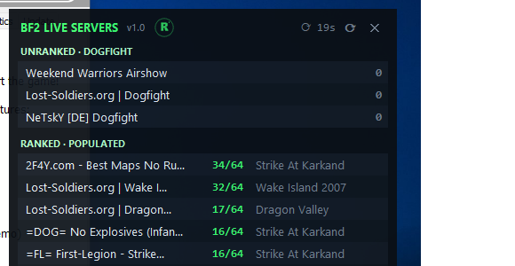

<p align="center"></p>

# BF2 SERVER OVERLAY v1.1

Always-on-top popup showing live Battlefield 2 server info from [bf2hub.com](https://www.bf2hub.com) — see who's playing without alt-tabbing to a browser.



## What it shows

- **UNRANKED · DOGFIGHT** — the three deranked dogfight servers (name + live player count)
- **RANKED · POPULATED** — every ranked server with players, busiest first: name, players (e.g. 34/64), current map
- **Hover any server** — a panel pops up beside the overlay (whichever side has room) listing the players on both teams, live from that server's page; idle/placeholder entries shown dimmed
- Auto-refreshes every 30 seconds, with a countdown and a manual refresh button

## Install (Windows)

1. Download **BF2-SERVER-OVERLAY-Setup-1.1.exe** from [Releases](../../releases)
2. Run it. First run installs the app to `%LOCALAPPDATA%\Programs\BF2 Server Overlay` and creates a Desktop shortcut, then opens the overlay.

> Windows SmartScreen will warn because the exe is unsigned — click **More info → Run anyway**. No Python or anything else needed; the exe is fully self-contained.

## Use

- Drag it anywhere by the title bar — it remembers its position
- `⟳` = refresh now · `✕` or `Esc` = close
- Stays on top of other windows (shows over BF2 in windowed/borderless mode)

## Run from source

Pure Python 3.12 standard library — no packages, no API keys.

```
python overlay.py                        # the overlay
python overlay.py --once                 # console selftest (prints parsed server data)
python overlay.py --players IP:PORT      # console selftest (prints a server's team lists)
```

Rebuild the exe:

```
python -m PyInstaller --onefile --noconsole --name "BF2 SERVER OVERLAY" --icon "<absolute path>\build\icon.ico" overlay.py
```

## Logo

RMO · Ribby Map Overlay — a dot-matrix R inside a dotted radar ring. Generator and render pipeline in `build/logo-explore/gen.html` + `build/render.cjs`.

---

Made by ribbycag3 - free to share 2026 · MIT license
